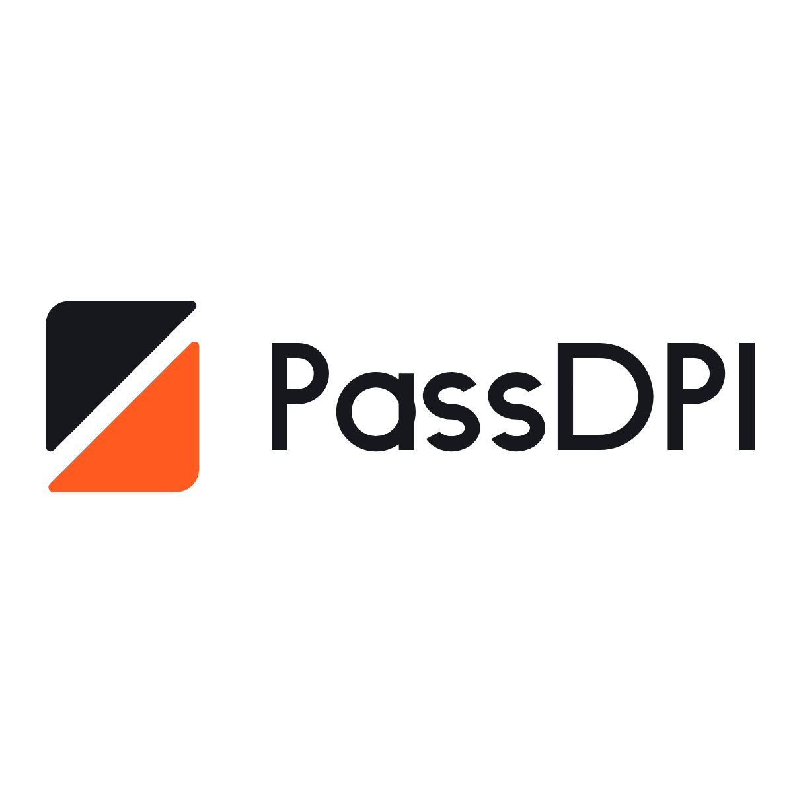

# PassDPI logo kit

**Idea:** a packet split in two and slid past itself. GoodbyeDPI splits traffic into pieces so the ISP's
filter can't read it. The orange half is the piece that got through.

## 1. Versions and files

| Use | File |
|---|---|
| Primary (horizontal) | `master/passdpi-horizontal.svg` · reversed: `master/passdpi-horizontal-reversed.svg` |
| Stacked | `master/passdpi-stacked.svg` |
| Symbol only | `master/passdpi-symbol.svg` · reversed: `master/passdpi-symbol-reversed.svg` |
| Small sizes (≤ 48 px) | `master/passdpi-symbol-small.svg` (wider gap, fills more of the canvas) |
| Wordmark only | `master/passdpi-wordmark.svg` |
| App icon (dark tile) | `master/passdpi-app-icon.svg` |
| Windows icon | `export/windows/passdpi.ico` (16, 24, 32, 48, 64, 128, 256 px) |
| Web icons | `export/web/` (favicon.ico/svg, apple-touch, 192/512, maskable, `site.webmanifest`, `head-snippet.html`) |
| One-colour | `export/*/…-black.svg`, `…-white.svg`, `…-mono-16181d.svg`, `…-mono-ff5a1f.svg` (symbol) |
| PNGs | `export/png/` (1200 px) and size sets in `export/symbol/` |
| Presentation | `presentation.html`, slide images in `slides/` |

All masters are pure vector paths: no live text, no embedded fonts or images, no effects.
`build.py` regenerates every master from its geometry, so edit the numbers there rather than the SVGs.

## 2. Construction
- **Symbol:** a 180-unit square cut along its 45° diagonal. Each half is pushed 11 units away from the cut
  and slid 14 units along it. Outer corners have a 24-unit radius and the cut corners have a 5-unit radius.
  The small-size cut uses a 32-unit gap, a 10-unit slip and a 212-unit square.
- **Wordmark:** constructed geometric letters on a 16-unit stroke, with a cap height of 112 and an x-height of 80.
  The round letters (a, s) overshoot the baseline and x-height by 1.5 units. The angled ends of the s echo the diagonal cut.
- **Horizontal lockup:** the wordmark's cap height is 0.57 × the symbol's height. The gap between symbol and
  wordmark is 28 units on the 256-unit canvas (56 units from the symbol's visible edge).

## 3. Clear space
Keep a clear space of at least **x** on every side, where **x = ¼ of the symbol's height**. It scales with the logo.

## 4. Minimum size
| Version | Screen | Print |
|---|---|---|
| Horizontal | 96 px wide | 25 mm wide |
| Stacked | 64 px wide | 18 mm wide |
| Symbol | 16 px (use the small cut below 48 px) | 5 mm |

## 5. Colour
| Name | HEX | RGB | CMYK (approx.) | Pantone (closest, check against a swatch) |
|---|---|---|---|---|
| Signal Orange | `#FF5A1F` | 255 90 31 | 0 75 90 0 | Orange 021 C |
| Ink | `#16181D` | 22 24 29 | 70 60 50 85 | Black 6 C |
| White | `#FFFFFF` | 255 255 255 | 0 0 0 0 | — |

**Approved logo/background pairs:**
- full colour (Ink + Orange) on white or light grey
- reversed (White + Orange) on Ink or any dark background
- all-black on white
- all-white on Orange or on photos (use a calm area)

**Accessibility:** Orange on white has a contrast ratio of about 3.1:1, which is fine for the logo and large
graphics but not for body text. Ink on Orange is about 5.7:1.

**App accent:** the app currently uses blue `#4F8CFF` as its accent (`src/PassDpi.App/Themes/*.xaml`). The logo works
next to it, but switching the accent to Signal Orange would make the app and the brand feel like one product.

## 6. Typography
The wordmark is custom-drawn, so no font licence is involved. For headings and UI next to the logo, use **Segoe UI
Variable** (the Windows system font the app already uses). On the web, use the stack
`"Segoe UI Variable", "Segoe UI", system-ui, sans-serif`.

## 7. Don'ts
- Don't stretch, rotate or mirror the logo; mirroring reverses the direction of the slip.
- Don't close the gap or put the halves back together.
- Don't swap the colours: the orange piece is always the lower-right one.
- Don't add shadows, outlines or gradients.
- Don't type "PassDPI" in a font to stand in for the wordmark.
- Don't put the full-colour version on dark backgrounds: the Ink half disappears, so use the reversed version.

## 8. Handover notes
- **Tests run:** rendered at 16–1200 px; checked at 16 and 32 px, in one colour, reversed and as an app icon. The SVG
  audit gives 100/100 on every master.
- **Not done:** CMYK/PDF/EPS print masters (no vector print tool was available here; open the SVGs in Illustrator,
  Inkscape or Affinity and save as PDF/EPS); the new icon has not been swapped into the app.
- **Trademark:** not cleared. Before public use, run a trademark search (e.g. TÜRKPATENT, EUIPO, WIPO Global Brand
  Database) and a reverse image search for split-square marks.
